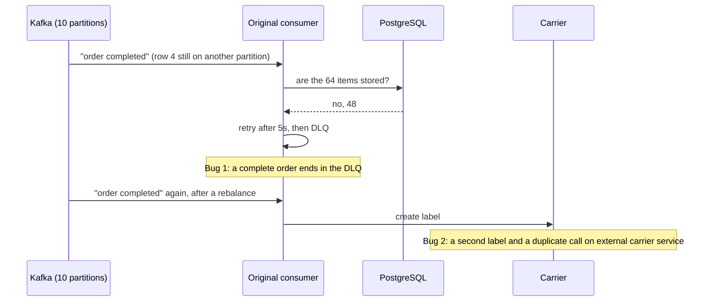
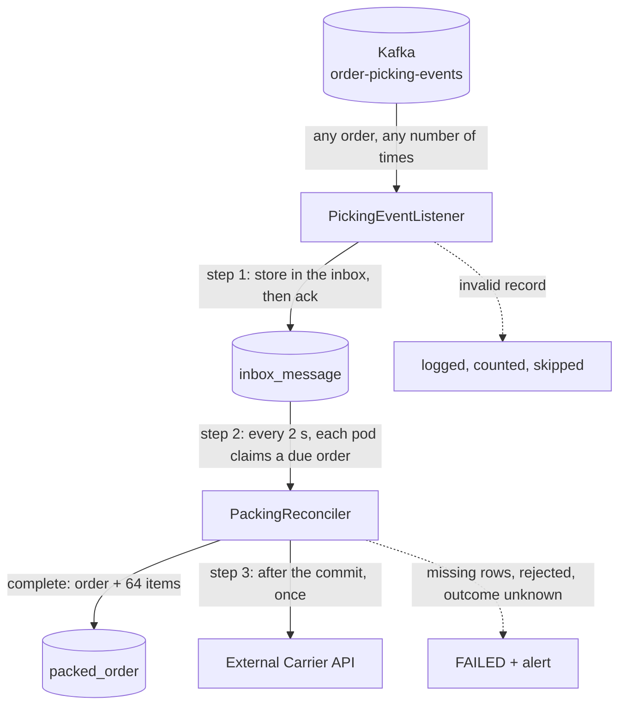

# Order Packing Service

This service consumes picking events from Kafka, decides when an order is complete, and creates 
**exactly one** shipping label per order at an external carrier service that is not idempotent. 
Orders that cannot complete this flow are marked as `FAILED` with an alert: they are never stuck 
and never labelled twice.

> The order packing is a mock domain of a real use case. Only the shape of the problem matches the real use case.

## The problem

An order has 64 items, split in 4 rows of 16 items. Each row is a Kafka message and a 5th
message "order completed", creates the label at the carrier. The Kafka producer is not ours and the 5 messages
could arrive in different partitions and also in any order (no ordering ensured by producer, since the
messages could be delivered in different partitions). Also, a rebalance can redeliver a message that was 
already processed. The original consumer acted on messages arrival:


## The proposed solution - How it works

The messages arrival order and redeliveries stop mattering: the listener only **stores** messages and a
reconciler **decides** the next action by looking at the whole order in the database.



1. **Receive**
   1. Every message is inserted into `inbox_message`. 
   2. Unique constraints protect the flow from a redelivery or a duplicated (re-sent). 
   3. The offset is acknowledged only after the commit.
2. **Reconcile** 
   1. Every pod claims due "order completed" records with `FOR UPDATE SKIP LOCKED`, one
      order per short transaction. 
   2. Complete (rows exactly `1..4`): store the order and its items, mark it as `LABEL_REQUESTED`. 
   3. Incomplete rows: wait with exponential backoff. After 10 checks, it is marked `FAILED` (`MISSING_ROWS`).
3. **Label** 
   1. After the commit, the external carrier service is called once, outside any transaction.
   2. If it returns `201`, it is marked as `PROCESSED`. 
   3. No connection or return `429`, wait and retry. 
   4. Other `4xx` errors are marked as `FAILED` (`CARRIER_REJECTED`). 
   5. Timeout or `5xx` errors: the label may exist, so it is **never** called again: `FAILED` 
   (`LABEL_OUTCOME_UNKNOWN`) for a person / caller to check. 
   6. Also, if a pod dies during the external call, the reconciler fails that order the same way after 5 minutes.

## Guarantees and the tests that prove them

Every test publishes real records to Kafka (Testcontainers), runs against PostgreSQL 18 and
WireMock as the external carrier service, and asserts on what an operator would see: database rows, 
carrier requests and metrics. There are no unit tests (D-013).

| Invariant                                                                                                | Proven by                                                                        |
|----------------------------------------------------------------------------------------------------------|----------------------------------------------------------------------------------|
| **I1** An order is never marked packed, and the carrier is never called, before its 4 rows are persisted | `OrderCompletedArrivesFirstTests`, `MissingRowTests`, `ShuffledMessagesTests`    |
| **I2** The external carrier service is never called twice for the same order                             | `ConcurrentReconcilersTests`, `CarrierFailuresTests`, `RedeliveredMessagesTests` |
| **I3** A message is never processed twice                                                                | `RedeliveredMessagesTests`, `ShuffledMessagesTests`                              |
| **I4** A message is never lost                                                                           | `RedeliveredMessagesTests`, `InvalidMessageTests`                                |
| **I5** An order is never stuck silently                                                                  | `MissingRowTests`, `CarrierFailuresTests`                                        |

All in [`src/test/.../integration`](src/test/java/pt/paulotrevizan/orderpacking/integration).
`ConcurrentReconcilersTests` fails with a duplicate carrier request if `SKIP LOCKED` is removed.

## Running it

Prerequisites: **Java 25** (`JAVA_HOME` must point to it) and **Docker**.

```bash
./mvnw verify      # macOS / Linux
mvnw verify        # Windows
```

`verify` runs the 19 scenario tests and Spotless (google-java-format)
`./mvnw spotless:apply` formats the code.

### Running locally and the demo

```bash
docker compose up -d                                              # PostgreSQL, Kafka, external carrier (WireMock)
./mvnw spring-boot:run -Dspring-boot.run.profiles=local           # the service
./mvnw spring-boot:run -Dspring-boot.run.profiles=local,demo      # second terminal: publish the demo
```

The demo publishes three orders with new ids on every run, logs them and exits:

| Scenario                               | Expected end state                                                |
|----------------------------------------|-------------------------------------------------------------------|
| out of order - "order completed" first | `PROCESSED`, one external carrier request                         |
| redelivered - every message twice      | `PROCESSED`, one external carrier request, 5 inbox rows           |
| missing row - row 3 never sent         | `FAILED` / `MISSING_ROWS` after ~30s, no external carrier request |

How to watch / inspect the results:

```bash
# Inbox state per order
docker compose exec postgres psql -U order_packing -d order_packing -c "select order_id, type, count(*) as rows, string_agg(distinct status, ',') as status, max(failure_reason) as reason from inbox_message where order_id like 'DEMO-%' group by 1, 2 order by 1, 2"

# Requests the external carrier received
curl -s http://localhost:8089/__admin/requests
```

In Git Bash on Windows, prefix `docker compose exec` commands with `MSYS_NO_PATHCONV=1`, or the
`/opt/...` path is rewritten. The `local` profile lowers the attempts to 5 so the missing row
fails in seconds instead of minutes.

## Configuration

Connections and secrets are coming from environment variables and local values live only in
`application-local.yaml`.

| Setting                               | Default                                             | Environment variable                                                                |
|---------------------------------------|-----------------------------------------------------|-------------------------------------------------------------------------------------|
| Database                              | -                                                   | `SPRING_DATASOURCE_URL`, `SPRING_DATASOURCE_USERNAME`, `SPRING_DATASOURCE_PASSWORD` |
| Kafka                                 | -                                                   | `SPRING_KAFKA_BOOTSTRAP_SERVERS`                                                    |
| External Carrier base URL             | -                                                   | `CARRIER_BASE_URL`                                                                  |
| Topic                                 | `order-picking-events`                              | `ORDER_PACKING_KAFKA_TOPIC`                                                         |
| Consumer group / listener concurrency | `order-packing-service` / 3                         | `SPRING_KAFKA_CONSUMER_GROUP_ID`, `SPRING_KAFKA_LISTENER_CONCURRENCY`               |
| Reconciler poll / batch size          | 2s / 20                                             | `ORDER_PACKING_PACKING_POLL_INTERVAL`, `ORDER_PACKING_PACKING_BATCH_SIZE`           |
| Backoff                               | 2s * 2, capped at 60s, +-20%                        | `ORDER_PACKING_PACKING_INITIAL_BACKOFF`, `_MAX_BACKOFF`, `_JITTER`                  |
| Max attempts                          | 10 (~5 min)                                         | `ORDER_PACKING_PACKING_MAX_ATTEMPTS`                                                |
| Label timeout (pod died during call)  | 5 min                                               | `ORDER_PACKING_PACKING_LABEL_TIMEOUT`                                               |
| External Carrier timeouts             | connect 2s / read 5s                                | `SPRING_HTTP_CLIENTS_CONNECT_TIMEOUT`, `SPRING_HTTP_CLIENTS_READ_TIMEOUT`           |

The topic is created by the platform, not by the service (D-016). Locally it is created by `docker compose`.

## Operating it

| Signal                                                                            | Meaning                                                                                                 |
|-----------------------------------------------------------------------------------|---------------------------------------------------------------------------------------------------------|
| `order_packing_orders_total{outcome=failed, reason}` + `ERROR "Order failed"` log | An order needs a person to check it (alert on it)                                                       |
| `order_packing_carrier_calls_total{outcome=refused}` rising                       | The external carrier service is unreachable. Orders wait and retry                                      |
| `order_packing_inbox_backlog`                                                     | Due orders waiting for the reconciler. A steady rise means it is not keeping up                         |
| `order_packing_inbox_messages_total{result=duplicate}`                            | Redeliveries absorbed by the inbox                                                                      |
| `order_packing_invalid_records_total` + `ERROR "Invalid record skipped"` log      | A record could not be read or validated; the log gives its topic, partition and offset                  |
| `/actuator/health/readiness`                                                      | Readiness `DOWN` without the database connection. Liveness stays `UP`, so an outage never restarts pods |

Failed order reasons and what to do (`failure_reason` in `inbox_message`, also in the `ERROR "Order failed"` log):

- **`MISSING_ROWS`** - the rows listed in the log are all that arrived. Find
  the missing one upstream and then, replay the order.
- **`CARRIER_REJECTED`** - the carrier refused the order (4xx). Fix the data, then replay.
- **`LABEL_OUTCOME_UNKNOWN`** - the label **may exist**. Check the external carrier service before doing anything:
  replaying blindly is how duplicate shipments happen. If the log has
  `Label created but not recorded … orderId=abc456, labelId=xyz123`, the label exists and the log has its id.

An invalid record is not an order: the `Invalid record skipped` log gives its position, enough to
read it again from Kafka while the topic retains it.

Replay is out of scope here (D-015). The original service sends failed orders to a DLQ and replays them (A6); here a failed order stays `FAILED` in the database. 
A replay must reset the existing inbox row (status FAILED → WAITING, set attempts as 0) instead of re-publishing. As a re-published message will hit inbox_event_id_unique and will be ignored.

## Design

- [docs/HLD.md](docs/HLD.md) - invariants, constraints and assumptions, flows, contracts, data model, failure modes.
- [DECISIONS.md](DECISIONS.md) - every decision (D-001 to D-016) with the options and trade-offs.

```
inbox/        receive: listener, inbox writer, inbox entity and claim queries
packing/      decide: reconciler, completion, carrier call, retry policy
integration/  the carrier's declarative HTTP client
common/       cross-cutting: clock, Kafka properties, scheduling, base entity
demo/         profile "demo": the demo publisher
```

Built with Java 25, Spring Boot 4.1, Spring for Apache Kafka, PostgreSQL 18 and Flyway.

---

## Notes and AI usage disclaimer

- This project is an independent, from scratch reconstruction of a solution I originally designed and implemented in a previous professional project, 
re-built and adapted to a neutral domain. 
The architecture, design decisions, and trade-offs reflect my own engineering judgment. No proprietary source code or confidential business information 
is included.
- AI tools were used for project bootstrapping, code review, documentation (including drafting this README and creating and maintaining HLD.md and 
DECISIONS.md), and test implementation. I reviewed and validated the generated output and remain responsible for the final implementation and its design 
decisions.


