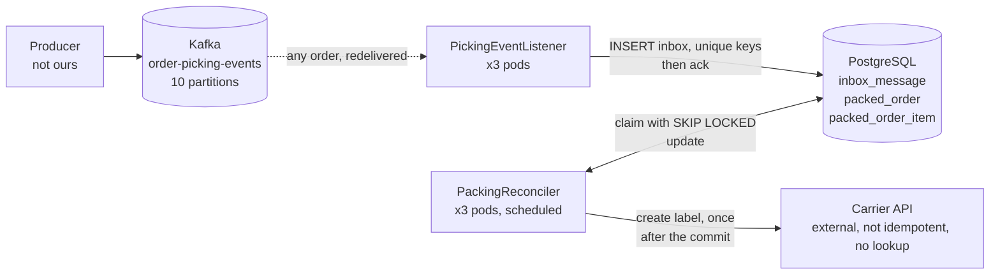

# Order Packing Service - High Level Design

> Decisions log: [DECISIONS.md](../DECISIONS.md)
>
> The order-packing domain is a stand-in; only the shape of the problem matches the real case.

## 1. Problem

An order has 64 items, picked in 4 rows of 16 items. Each row arrives as one Kafka message, 
and a 5th message, "order completed", must create the shipping label at an external carrier service and release
the order for dispatch. The Kafka producer is not ours and the 5 messages could arrive in different 
partitions and also in any order (no ordering ensured by producer, since the messages could be delivered 
in different partitions). Also, a rebalance can redeliver a message that was already processed. The 
original consumer processed each message on arrival: when "order completed" came before the last row, 
persisting the order failed and, after a 5s retry, often ended in the DLQ. When "order completed" was 
redelivered, the external carrier service, which is not idempotent, created a second label and a duplicate 
shipment.

## 2. Invariants

These are the properties the solution must **never** violate. Every design choice below exists
to protect one of them.

| #      | Invariant                                                                                         | Enforced by                                                                                                                                 |
|--------|---------------------------------------------------------------------------------------------------|---------------------------------------------------------------------------------------------------------------------------------------------|
| **I1** | An order is never marked packed, and the carrier is never called, before its 4 rows are persisted | Completeness check by the reconciler, in the same transaction that moves the order to `LABEL_REQUESTED` (D-002, D-004)                      |
| **I2** | The external carrier service is never called twice for the same order                             | State committed before the call + `SKIP LOCKED` claims. An unknown outcome goes to manual check, never to an automatic retry (D-003, D-005) |
| **I3** | A message is never processed twice                                                                | Unique constraints on the inbox table: `event_id`, `(order_id, row_number)`, one `ORDER_COMPLETED` per order (D-001, D-004)                 |
| **I4** | A message is never lost                                                                           | Kafka offset acknowledged only after the inbox commit (D-009)                                                                               |
| **I5** | An order is never stuck silently                                                                  | Every order ends `PROCESSED` or `FAILED` + alert. Max attempts bound the wait; a carrier outage retries unbounded, visibly (D-006, D-007)   |

> I1 and I3 come from the database, not from arrival order: it does not matter which partition
> or pod delivers what, or how many times.

## 3. Constraints and assumptions

| #  | Constraint or assumption                                                                              | Why it holds                                                                            |
|----|-------------------------------------------------------------------------------------------------------|-----------------------------------------------------------------------------------------|
| A1 | Every row message carries `orderId` and a `rowNumber` (1–4). "Order completed" carries `expectedRows` | Without it, "complete" cannot be defined                                                |
| A2 | A redelivered message keeps its `eventId`                                                             | Standard for Kafka producers. It is what makes the inbox dedup work                     |
| A3 | The external carrier service has no idempotency key and no lookup endpoint: we can only send events   | It is the real constraint. An unknown outcome is resolved by a human (D-005)            |
| A4 | A delay of seconds between "order completed" and the label is acceptable                              | Dispatch is not real-time. It is what lets the reconciler poll                          |
| A5 | The producer's partitioning is not ours to change                                                     | Re-keying by `orderId` would fix ordering at the source, but it belongs to another team |
| A6 | The original system replays failed orders through its own DLQ path, owned elsewhere                   | Out of scope here (§10, D-015)                                                          |

## 4. Requirements

### Functional

| #   | Requirement                                                                                                     |
|-----|-----------------------------------------------------------------------------------------------------------------|
| FR1 | Consume row-completed and order-completed messages from Kafka                                                   |
| FR2 | Persist each order with its 4 rows and 64 items                                                                 |
| FR3 | Once an order is complete and "order completed" has arrived, create exactly one shipping label at the carrier   |
| FR4 | Release the order for dispatch only after its label exists (FR3); here it ends `PROCESSED` with its label (§10) |
| FR5 | Surface orders that never complete (`FAILED` + alert)                                                           |

### Non-functional

| #    | Requirement   | Number / constraint                                                                                                                                                                                      |
|------|---------------|----------------------------------------------------------------------------------------------------------------------------------------------------------------------------------------------------------|
| NFR1 | Volume        | ~41M/month, ~16 msg/s average                                                                                                                                                                            |
| NFR2 | Peaks         | Load concentrates in peak hours, the peak factor is not measured. Even 10x (~160 msg/s, ~32 orders/s) is a light write load for PostgreSQL; the carrier calls run in parallel workers to keep up (D-003) |
| NFR3 | Ordering      | None across the messages of one order                                                                                                                                                                    |
| NFR4 | Delivery      | At-least-once: redeliveries on rebalance are expected                                                                                                                                                    |
| NFR5 | Idempotency   | The external carrier service is never called twice for the same order                                                                                                                                    |
| NFR6 | Scaling       | Up to 3 pods on 10 partitions. Adding pods must not break NFR5                                                                                                                                           |
| NFR7 | Latency       | Seconds between "order completed" and the label are acceptable                                                                                                                                           |
| NFR8 | Storage       | ~41M inbox rows/month: retention is required (extension point, §10)                                                                                                                                      |
| NFR9 | Observability | Every failed order alerts; inbox backlog is a metric                                                                                                                                                     |

## 5. Architecture



### Components

| Component              | Responsibility                                                                                                                                                                                                  |
|------------------------|-----------------------------------------------------------------------------------------------------------------------------------------------------------------------------------------------------------------|
| `PickingEventListener` | Deserializes a record, calls `InboxWriter`, acknowledges after commit. Invalid records are logged, counted and skipped (D-008)                                                                                  |
| `InboxWriter`          | Inserts the message. A unique violation on an inbox constraint = duplicate, ignored (I3)                                                                                                                        |
| `PackingReconciler`    | Scheduled on every pod, with parallel workers (D-003): claims due `ORDER_COMPLETED` records, checks completeness, completes or reschedules or fails them. Fails label requests abandoned by a crashed pod (6.4) |
| `LabelRequester`       | Calls the carrier for orders this instance moved to `LABEL_REQUESTED`, outside any transaction                                                                                                                  |
| `CarrierClient`        | Declarative HTTP client for the carrier (`@PostExchange`), bounded timeouts                                                                                                                                     |

## 6. Flows

### 6.1 Receive (listener)

1. Record arrives on `order-picking-events` → deserialize and validate. Invalid → logged with its
   position, counted and skipped, no retry (D-008).
2. In one transaction: insert into `inbox_message` with status `RECEIVED`, `next_attempt_at = now`.
3. Unique violation on `inbox_event_id_unique`, `inbox_order_row_unique` or
   `inbox_order_completed_unique` → duplicate: log and treat as success (I3).
4. Acknowledge the offset (I4). A crash before step 4 → redelivery → step 3.

### 6.2 Reconcile (scheduled, every pod)

Each cycle runs `workers` parallel workers, each handling up to `batch-size` orders,
**one short transaction per order** (D-003), so one order never holds back or rolls back another.
`SKIP LOCKED` keeps any two workers, on the same pod or not, off the same order. Each worker:

1. Claim the next due `ORDER_COMPLETED` record (status `RECEIVED`/`WAITING`,
   `next_attempt_at <= now`, oldest first), `FOR UPDATE SKIP LOCKED`.
2. Collect the distinct `row_number` of its order's `ROW_COMPLETED` records (D-004).
3. **Complete** (the row numbers are exactly `1..expectedRows`): persist `packed_order` +
   64 `packed_order_item` (if not already persisted), mark the record `LABEL_REQUESTED` with
   `label_requested_at = now` (I1).
4. **Incomplete**, attempts left: `WAITING`, `attempts + 1`, `next_attempt_at = now + backoff` (D-006).
5. **Incomplete**, attempts exhausted: mark `FAILED` (reason `MISSING_ROWS`), log at `ERROR`
   and count it: the alert (D-007).
6. Commit. If the order moved to `LABEL_REQUESTED`, run 6.3 for it now, outside the transaction.

An error (for example the database is down) stops that worker; the cycle waits for the others and the
next poll resumes the work.

### 6.3 Create the label (outside any transaction, D-005)

| Carrier outcome                                 | Meaning                              | Next state                                                                                              |
|-------------------------------------------------|--------------------------------------|---------------------------------------------------------------------------------------------------------|
| `201` + `labelId`                               | Label created                        | `PROCESSED`; `packed_order.carrier_label_id` set; the order's `ROW_COMPLETED` records → `PROCESSED`     |
| Connection refused or connect timeout, or `429` | Request never sent, or not processed | `WAITING` with backoff; retried for as long as the carrier is unavailable (D-006)                       |
| `4xx`                                           | Carrier rejected the order           | `FAILED`, reason `CARRIER_REJECTED`                                                                     |
| Read timeout, `5xx`, other I/O error            | Unknown: the label may exist         | `FAILED`, reason `LABEL_OUTCOME_UNKNOWN`: a person checks the carrier; never called again automatically |

`ROW_COMPLETED` records only go `RECEIVED → PROCESSED` (when their order is processed).

### 6.4 Abandoned label requests (part of every reconcile cycle)

If a pod dies between committing `LABEL_REQUESTED` and recording the carrier's outcome, nobody
records it. At the start of each cycle the reconciler claims `LABEL_REQUESTED` records with
`label_requested_at < now - label-timeout` (`FOR UPDATE SKIP LOCKED`) → `FAILED` (reason
`LABEL_OUTCOME_UNKNOWN`) + alert, and a person checks the carrier. The label timeout
(5 min) is far above the carrier read timeout (5 s), so a call still in flight is never failed.

## 7. Contracts

### 7.1 Inbound - topic `order-picking-events` (JSON value, 10 partitions)

JSON here for simplicity; the original contract is Avro with a schema registry (D-010).

```json
{ 
  "eventId": "6f1c…", 
  "type": "ROW_COMPLETED", 
  "orderId": "ORD-1001", 
  "occurredAt": "2026-10-15T10:00:00Z",
  "rowNumber": 2, 
  "items": [ 
    { 
      "sku": "SKU-42", "quantity": 1
    } 
  ]
}
```

```json
{ 
  "eventId": "9a7e…", 
  "type": "ORDER_COMPLETED", 
  "orderId": "ORD-1001", 
  "occurredAt": "2026-10-15T10:00:05Z",
  "expectedRows": 4
}
```

Validation: `eventId`, `type`, `orderId`, `occurredAt` required; `ROW_COMPLETED` needs
`rowNumber` between 1 and 4 and a non-empty `items` list; `ORDER_COMPLETED` needs
`expectedRows` between 1 and 4 (an order is always picked in 4 rows, A1). Limits mirror the
schema, so a valid record can always be stored (D-016): `orderId` and `sku` at most 64 characters,
item `quantity ≥ 1`.

### 7.2 Outbound

None. A failed order stays in the database as `FAILED` with its reason (`MISSING_ROWS` |
`CARRIER_REJECTED` | `LABEL_OUTCOME_UNKNOWN`, D-007), and an invalid record is logged and skipped
(D-008). The original service publishes both to a dead-letter topic for its replay path (A6).

### 7.3 Carrier - `POST {spring.http.serviceclient.carrier.base-url}/labels`

Request: 
```json
{ 
  "orderId": "ORD-1001", 
  "items": 
  [ 
    { 
      "sku": "SKU-42", "quantity": 1
    } 
  ]
}
```        
Response `201`: `{ "labelId": "LBL-778" }`. No idempotency key, no lookup endpoint (A3).
Timeouts: connect 2s, read 5s.

## 8. Data model (PostgreSQL)

```sql
inbox_message (
  id                 uuid primary key,
  event_id           uuid        not null,             -- inbox_event_id_unique
  order_id           varchar(64) not null,
  type               varchar(20) not null,             -- ROW_COMPLETED | ORDER_COMPLETED
  row_number       smallint,                         -- required if ROW_COMPLETED
  expected_rows    smallint,                         -- required if ORDER_COMPLETED
  payload            jsonb       not null,             -- the message, re-serialized (D-016)
  status             varchar(20) not null,             -- RECEIVED | WAITING | LABEL_REQUESTED | PROCESSED | FAILED
  attempts           int         not null default 0,
  next_attempt_at    timestamptz not null,
  label_requested_at timestamptz,
  failure_reason     varchar(40),
  received_at        timestamptz not null,
  updated_at         timestamptz not null
)
-- unique (event_id) - inbox_event_id_unique
-- unique (order_id, row_number) where type = 'ROW_COMPLETED' - inbox_order_row_unique
-- unique (order_id) where type = 'ORDER_COMPLETED' - inbox_order_completed_unique
-- index (next_attempt_at) where type = 'ORDER_COMPLETED' and status in ('RECEIVED','WAITING')
-- index (label_requested_at) where status = 'LABEL_REQUESTED'
-- index (order_id)

packed_order (
  id               uuid primary key,
  order_id         varchar(64) not null,               -- packed_order_order_id_unique
  carrier_label_id varchar(64),
  packed_at        timestamptz not null,
  labelled_at      timestamptz
)

packed_order_item (
  id              uuid primary key,
  packed_order_id uuid not null references packed_order (id),
  row_number    smallint not null,
  sku             varchar(64) not null,
  quantity        int not null check (quantity > 0)
)
-- index (packed_order_id)
```

## 9. Configuration defaults

| Setting                                     | Default                                                             |
|---------------------------------------------|---------------------------------------------------------------------|
| Topic                                       | `order-picking-events` (10 partitions)                              |
| Consumer group                              | `order-packing-service`                                             |
| Listener concurrency per pod                | 3                                                                   |
| Listener retry (database down)              | 1s x2, capped at 30s, never skipped (D-016)                         |
| Reconciler poll interval / claim batch size | 2s / 20                                                             |
| Reconciler workers per pod / database pool  | 5 / 10 connections, the Hikari default (D-003)                      |
| Backoff                                     | 2s x 2 per attempt, capped at 60s, +-20 % jitter                    |
| Max attempts                                | 10 (~5 min of waiting)                                              |
| Label timeout (abandoned label request)     | 5 min                                                               |
| Carrier timeouts                            | connect 2s / read 5s                                                |

## 10. Out of scope (extension points)

- **Replay of failed orders** (D-015). The original system has one (A6). Here, a replay must reset
  the existing inbox row (`FAILED → WAITING`, attempts back to 0): re-publishing the message would
  hit `inbox_event_id_unique` and be ignored.
- **Inbox retention** (NFR8): a scheduled purge, or monthly partitions dropped after N days.
- **Event-driven fast path** (D-002): checking completeness right after the last insert, to cut latency.
- **Releasing the order downstream** (FR4) beyond storing the label id.
- **Orphan rows**: an alert on `ROW_COMPLETED` records still `RECEIVED` after a cutoff with no
  `ORDER_COMPLETED` for their order, a count like the backlog gauge. It never happens in the real flow,
  but nothing surfaces it today (§12).
- **Carrier circuit breaker**: the original system has one; it is left out here for simplicity. The
  backoff is per order, so during a carrier outage the waiting orders still add up to a steady call
  rate, and with a non-idempotent carrier every `5xx` or timeout is an order for a person to check
  (`LABEL_OUTCOME_UNKNOWN`). An open breaker would skip the call: a call never sent creates no label,
  so it maps onto `REFUSED` (back to `WAITING` with backoff) with no new state. `UNKNOWN` and
  connection failures would count, `REJECTED` would not (the carrier is healthy, the order is not).

## 11. Main trade-offs (what we chose and what it costs)

| #  | We chose                                              | We gave up                                                              | Why it is acceptable                                                   |
|----|-------------------------------------------------------|-------------------------------------------------------------------------|------------------------------------------------------------------------|
| T1 | Inbox before processing (D-001)                       | Immediate processing; one extra write and more transactions per message | Correct under any arrival order and any redelivery; the ack stays fast |
| T2 | Polling reconciler (D-002)                            | Up to one polling interval of latency; constant light DB load           | Labels are not real-time (A4); one place decides and it self-heals     |
| T3 | At-most-once carrier call (D-005)                     | Automatic recovery from an unknown outcome (timeout, crash mid-call)    | A duplicate shipment costs more than a delayed one                     |
| T4 | Guarantees in PostgreSQL (constraints, `SKIP LOCKED`) | Database portability                                                    | The same database already holds the orders                             |
| T5 | Fix on the consumer side                              | Fixing the producer's partitioning                                      | The producer is not ours (A5), and our fix also handles duplicates     |

## 12. Failure modes

| What fails                                 | When                                        | What happens                                                                                                               | Invariant kept |
|--------------------------------------------|---------------------------------------------|----------------------------------------------------------------------------------------------------------------------------|----------------|
| Pod crashes                                | Before the inbox commit                     | Kafka redelivers; inserted normally                                                                                        | I4             |
| Pod crashes                                | After the commit, before the ack            | Kafka redelivers; `inbox_event_id_unique` ignores it                                                                       | I3, I4         |
| "Order completed" arrives first            | Any time                                    | `WAITING`; completes on a later cycle once row 4 lands                                                                     | I1             |
| Row re-sent with a new `eventId`           | Any time                                    | `inbox_order_row_unique` ignores it                                                                                        | I3             |
| Two reconcilers                            | Same cycle                                  | `SKIP LOCKED`: each claims different orders                                                                                | I2             |
| Carrier unavailable (no connection, `429`) | During the call                             | Back to `WAITING`, retried with backoff for as long as it lasts; `refused` counter                                         | I2             |
| Carrier times out or answers `5xx`         | During the call                             | `FAILED` (`LABEL_OUTCOME_UNKNOWN`) + alert at once; never called again automatically                                       | I2, I5         |
| Pod crashes mid-call                       | After `LABEL_REQUESTED`, before the outcome | After the label timeout, the reconciler fails it: `FAILED` (`LABEL_OUTCOME_UNKNOWN`) + alert                               | I2, I5         |
| PostgreSQL down right after a `201`        | Recording the label                         | `ERROR` log with the order id and the label id; after the label timeout the reconciler fails it as `LABEL_OUTCOME_UNKNOWN` | I2, I5         |
| A row never arrives                        | -                                           | After max attempts, `FAILED` (`MISSING_ROWS`) + alert                                                                      | I5             |
| "Order completed" never arrives            | -                                           | Its rows stay `RECEIVED`: only `ORDER_COMPLETED` records are claimed, so nothing fails and nothing alerts (§10)            | -              |
| Invalid record                             | On receive                                  | Logged with its position, counted and skipped; offset committed. Still in Kafka while the topic retains it                 | -              |
| PostgreSQL down                            | Any time                                    | Listener retries without acknowledging, Kafka keeps the records; reconciler pauses; readiness `DOWN`                       | I4             |

## 13. Observability

- Counters: `order_packing_inbox_messages_total{type, result=stored|duplicate}`,
  `order_packing_invalid_records_total`,
  `order_packing_orders_total{outcome=processed|failed, reason}`,
  `order_packing_carrier_calls_total{outcome=created|refused|rejected|unknown}`.
- Gauge: `order_packing_inbox_backlog` (due `ORDER_COMPLETED` records).
- Every `FAILED` order logs at `ERROR` with `orderId` and reason (the alert hook).
- `/actuator/health/readiness` includes the database; `/actuator/health/liveness` does not, so an
  outage never restarts the pods. `/actuator/metrics` exposes the meters above.
